<div align="center">

  
  <br />
  <br />

  [](https://github.com/youngchris29-art/NuvioTV/graphs/contributors)
  [](https://github.com/youngchris29-art/NuvioTV/network/members)
  [](https://github.com/youngchris29-art/NuvioTV/stargazers)
  [](https://github.com/youngchris29-art/NuvioTV/issues)
  [](https://github.com/youngchris29-art/NuvioTV/blob/main/LICENSE)

  <p>
    A native Apple TV client for the Nuvio media hub, with SwiftUI over a shared Kotlin Multiplatform core.
    <br />
    Stremio addon ecosystem • Built for the tvOS focus engine &amp; Siri Remote
  </p>

</div>

## About

**NuvioTV** is a native **tvOS (Apple TV)** port of [Nuvio](https://github.com/NuvioMedia/NuvioMobile). It brings Stremio addons, catalogs, watch progress, collections, cloud library, debrid and Trakt into the living room through an interface made for the **tvOS focus engine** and **Siri Remote**.

This fork keeps the parts of NuvioMobile that suit a TV and leaves its touch UI behind. Its Compose-free **domain and data layer** becomes **`SharedCore`**, a UI-free Kotlin Multiplatform framework, with a new **SwiftUI** frontend on top. Mobile and TV share one business-logic core; Apple TV gets its own 10-foot interface.

> **Lineage:** the original *NuvioTV* was a React Native app. It was rewritten as [**NuvioMobile**](https://github.com/NuvioMedia/NuvioMobile), using Kotlin and Compose Multiplatform for Android and iOS. This project reclaims the *NuvioTV* name for a native Apple TV app. It shares NuvioMobile's core but replaces the UI and player for tvOS.

## Screenshots

| | |
|:---:|:---:|
|  <br/> **Home (Stage)**: the focused title's art, logo and synopsis above one row at a time |  <br/> **Search**: the system search field, suggestions, a Top result and rows by type |
| 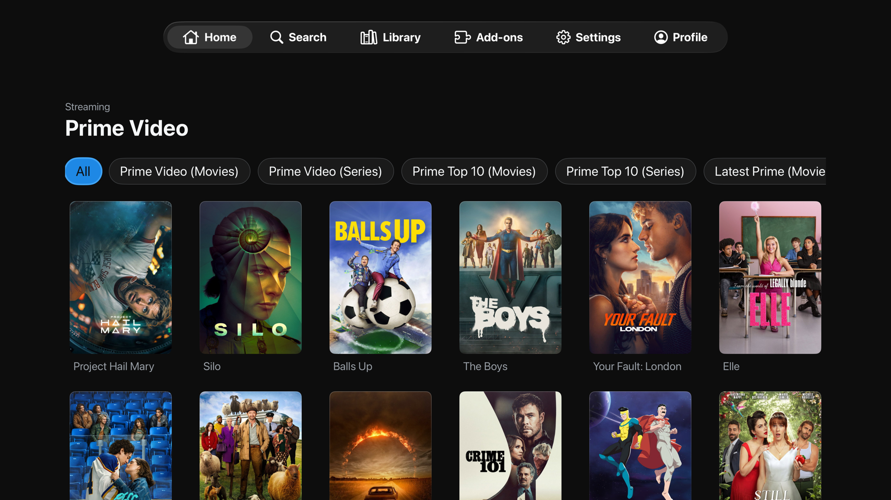 <br/> **Catalogs**: addon catalogs with filter chips |  <br/> **Detail (Cinematic)**: the logo, ratings and synopsis over a full-bleed backdrop, with studio and Parental Guide chips |
|  <br/> **Series**: hold a season poster to mark the season watched. Hide Spoilers blurs unwatched episodes |  <br/> **Player panel**: subtitle delay steps and Sync Line in the Subtitles tab |
| 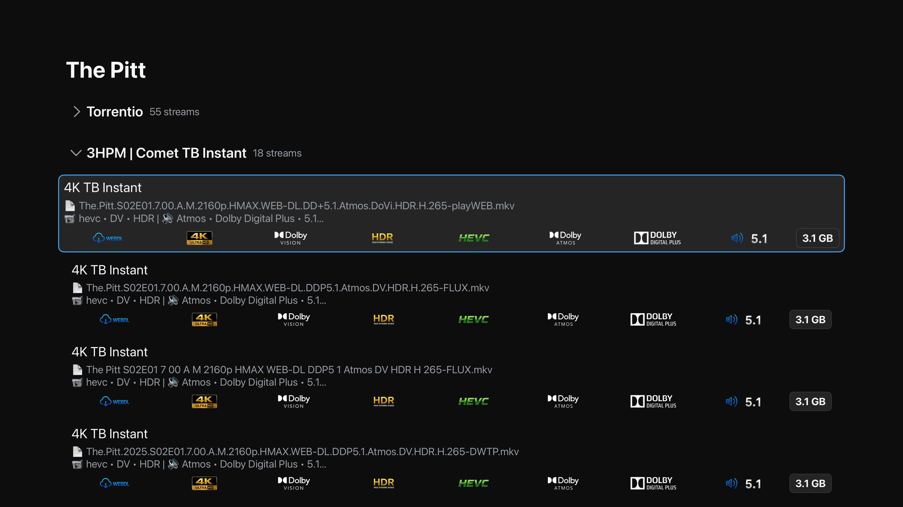 <br/> **Streams**: per-addon groups, debrid-cached & quality badges | 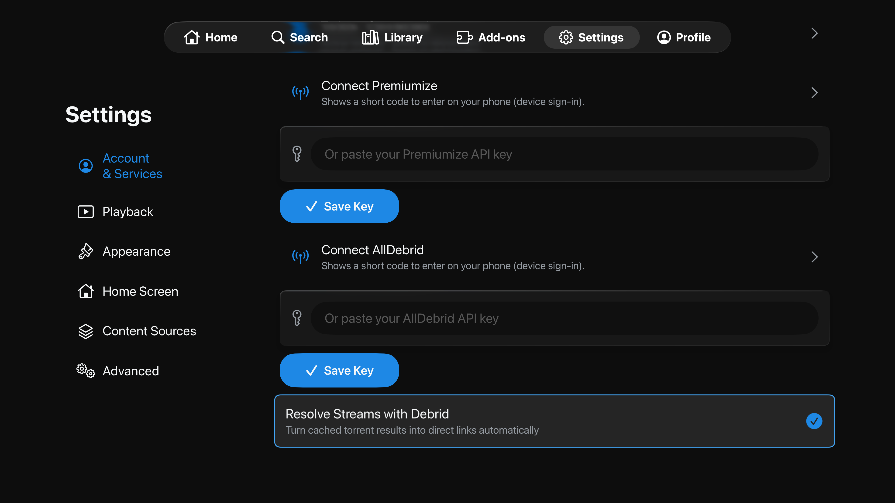 <br/> **Debrid**: TorBox, Premiumize, Real-Debrid & AllDebrid |
| 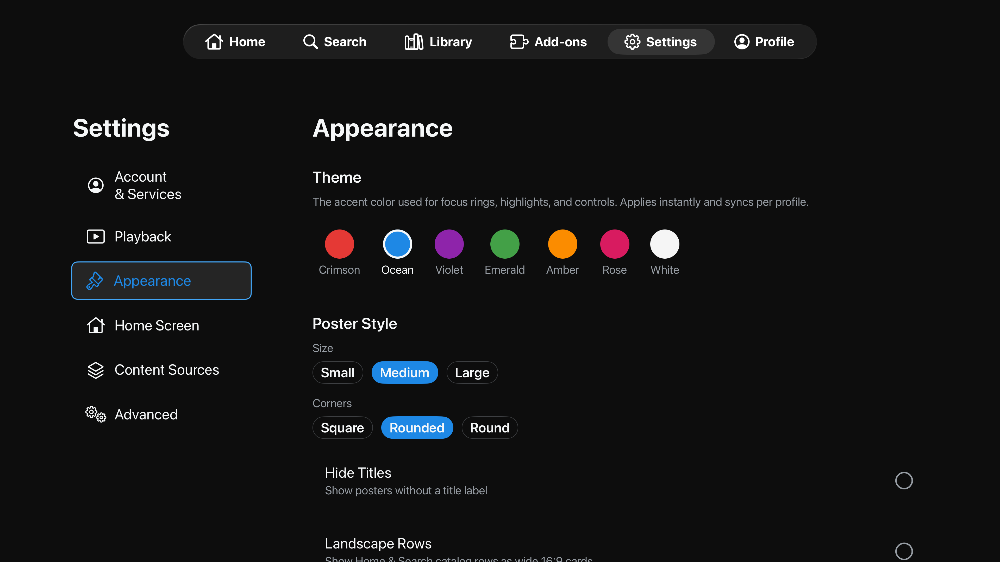 <br/> **Appearance**: accent themes & poster styles, synced per profile | 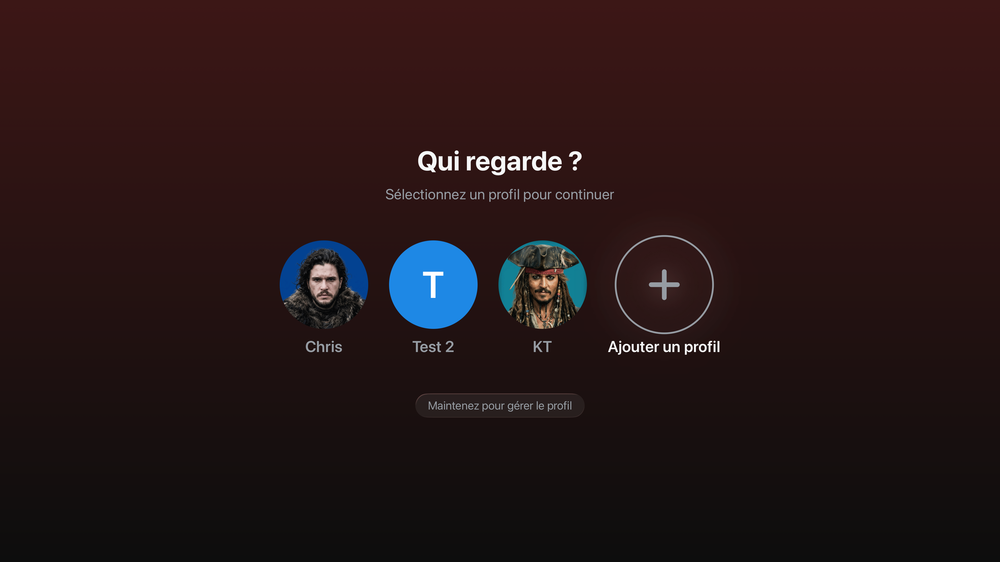 <br/> **Localized**: English, French, Spanish, German, Italian & Vietnamese |
| 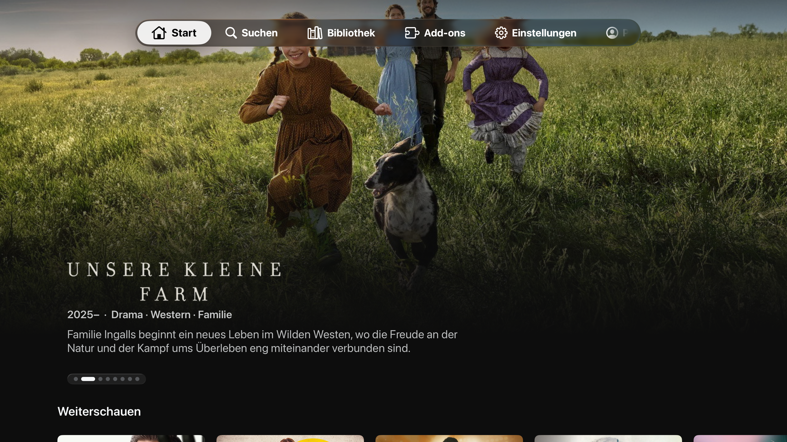 <br/> **Localized hero**: TMDB supplies title logos, synopsis & genres in your language | 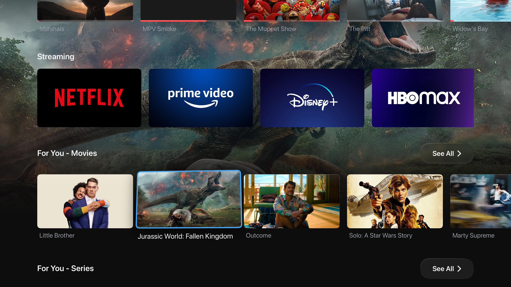 <br/> **Wide rows**: 16:9 cards with titles; the focused card lifts clear |
| 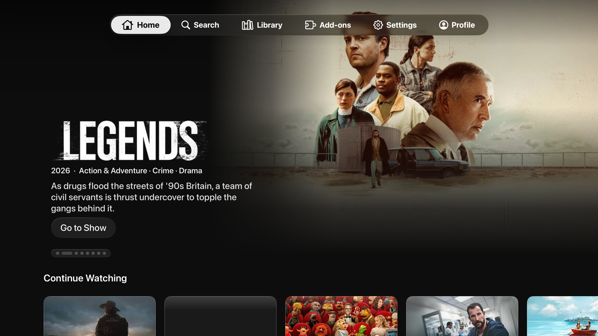 <br/> **Nuvio-Style Hero** (opt-in): information on the left, artwork blending in from the right | 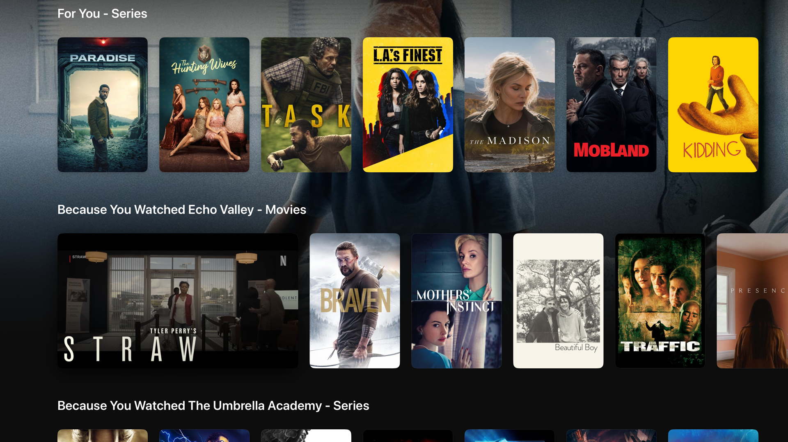 <br/> **Trailers on Focus**: the poster widens in its row and plays the trailer. When titles are hidden, the logo stays on the tile |
| 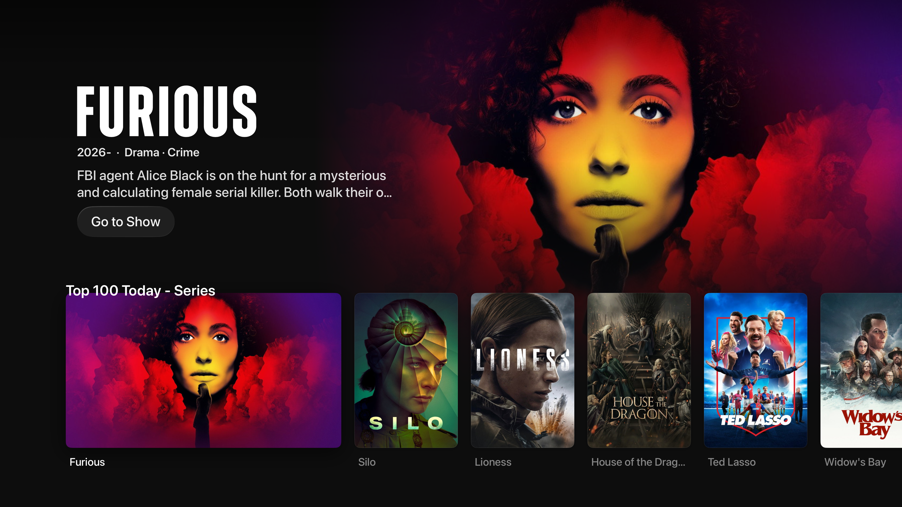 <br/> **Pinned hero**: with Nuvio-Style enabled, the hero follows the focused title while only the rows scroll | 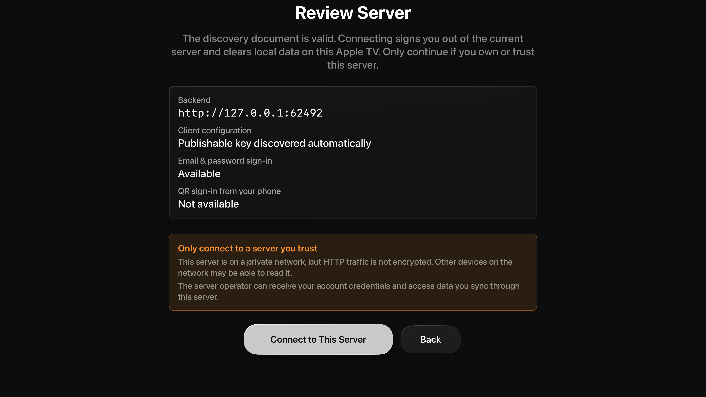 <br/> **Self-hosted servers**: connect to your own backend, with discovery, capability details & a trust review before switching |
| 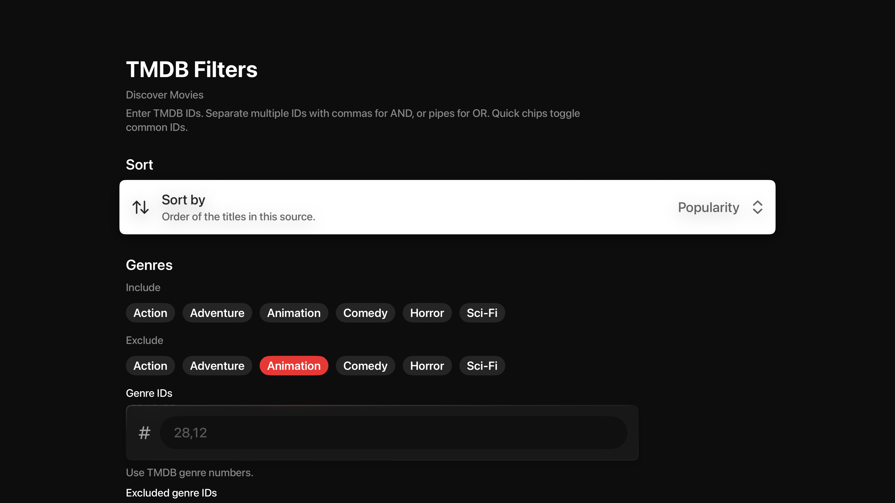 <br/> **TMDB filters on the TV**: edit a Discover folder's filters, including exclusions, on Apple TV and sync them to your account | 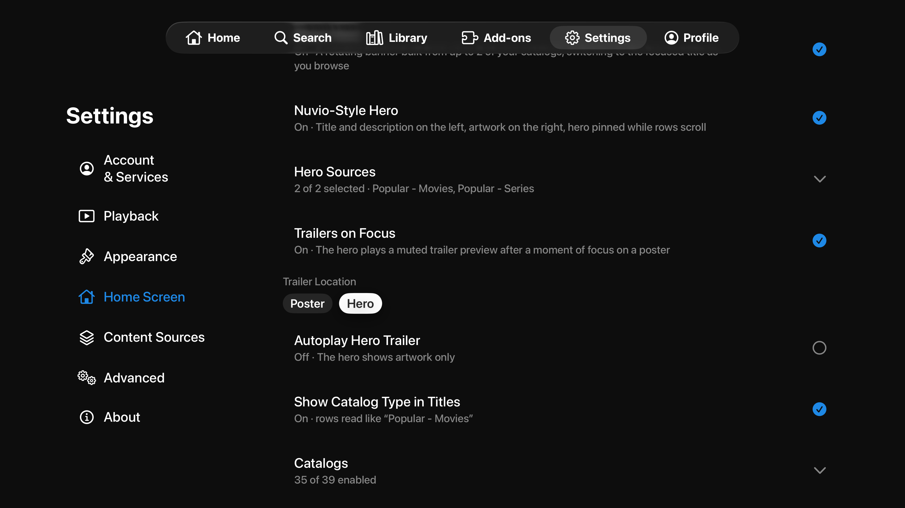 <br/> **Trailer Location**: play the focused title's trailer in the hero instead of widening the poster. Autoplay Hero Trailer needs no focus |
| 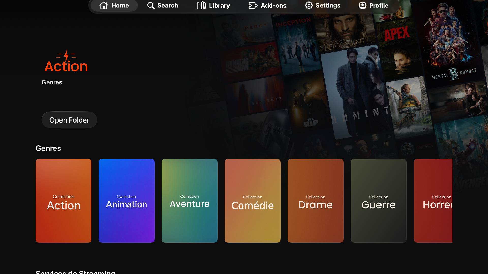 <br/> **Collection artwork in the hero**: focus a collection tile and the hero uses that folder's backdrop and title logo | 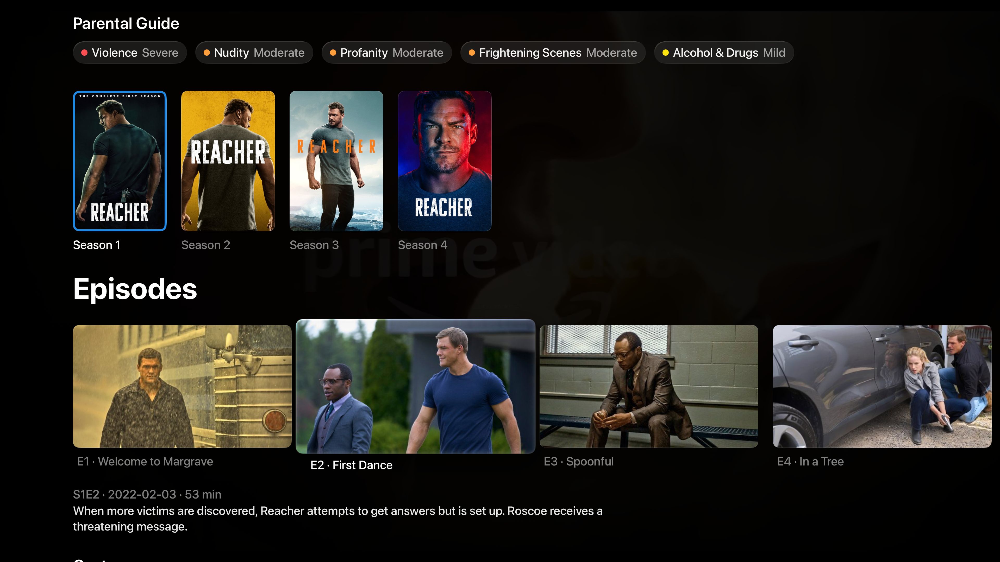 <br/> **Season posters**: the season row matches the More Like This tile size |
|  <br/> **Home (Classic)**: the hero carousel layout, picked under Home Layout |  <br/> **Collection folders**: the Stage layout inside a folder, one row per source |
|  <br/> **Rail, Centre**: a glass column of tabs on the left edge, with labels or icons only |  <br/> **Rail, Corner**: flush in the top-left corner, opening downward from the Home icon |
|  <br/> **Discover**: its own tab, a poster grid you narrow with the pills at the top |  <br/> **Library**: filter by type and watch state; posters show a tick or a progress bar |
|  <br/> **Square corners**: with Poster Corners on Square, the Detail buttons are square and one size |  <br/> **Loading screen**: the title logo pulses while a video starts, in your language |
|  <br/> **Settings**: grouped panes, with the focused row explained on the left |  <br/> **Subtitles & Audio**: Fallback Audio Language and Fallback Subtitle Language, None by default |

## Features

### True 10-foot UI

- **Stage is the new Home** (Settings → Home Screen → Home Layout: Stage, the default). The top of the screen is a fixed stage with the focused title's artwork, logo, details and synopsis. It never takes focus and never moves. Below it sits one row at a time: Up and Down move a whole row per click, and the next row's heading peeks in at the bottom. The stage switches to a new title once you rest on it for about half a second. Menu from a lower row returns to the first row, on the card you left. **Ambient Background** (Settings → Home Screen, on by default, Stage only) fills the screen behind it with a soft wash of the focused title's colors, and OLED True Black dims it. Titles you have watched carry a tick on every catalog row, and an add-on catalog that declares wide posters draws as 16:9 cards.
- **Collection folders** open in the same Stage layout, one row per source, starting on the first title's art and synopsis. **Collections Layout** (Settings → Home Screen) picks Rows or Grid for every folder, Rows by default on Stage and Grid on Classic, and holding a collection on Home gives that folder its own layout. **Show Catalog Details in Headings** (Settings → Appearance, off by default) adds the add-on name to row headings and the source count to folders.
- **Classic** (Home Layout: Classic) keeps the hero carousel Home described below. Show Hero, Nuvio-Style Hero, Hero Sources and Autoplay Hero Trailer appear only in that layout. In beta 19 its row headings land without dropping a notch, a collection in the Rows layout keeps the Classic look, and the synopsis shows up to four lines where they fit.
- **Navigation** (Settings → Appearance → Navigation) offers Top Tabs, the default, or the new **Rail**, a column of icons on the left. Left from the first card or Menu at the top of a tab opens the rail, Right closes it, and Select on an icon switches tab. Its rows appear under Navigation once Rail is picked. **Rail** is Always Visible (default), Hide While Browsing or Hidden. **Rail Position** is Centre (default), a glass pill on the left edge, or Corner, which sits flush in the top-left corner, opens downward and rests as the bare Home icon. **Rail Style** is Floating (default) or Edge, flat against the screen edge, and applies to Centre. **Rail Labels** is Shown (default) or Icons Only. A Sidebar choice from an earlier beta opens as the Rail. Top Tabs is the system tab bar: it minimizes as you scroll into content, following tvOS 26's own apps, and from deep in a page one **Menu** press returns to the top.
- **Search** uses the tvOS search field. The field and the keyboard row are on screen from the first frame, Siri Remote dictation works, and an iPhone keyboard can type into it. Results update as you type from the second letter, a new letter cancels the requests the last one started, and a slow add-on no longer holds the page. Results arrive grouped: suggestions, a **Top result** card with the year and type, Movies and Series rows merged across add-ons, and a **People** row from TMDB. **Search Results** (Settings → Sources) switches to one row per add-on. A search that comes back empty is retried once, and one that still fails says so. A search joins Recent Searches once you open one of its results.
- **Discover** is its own tab by default (Settings → Appearance → Discover: Own Tab, Under Search or Off). Off syncs per profile, as Hide Discover did. Discover opens on a poster grid with pills for the type, the genre and the catalog, and **Browse** shows one Stage row per genre. Its menus and genre names follow the app language.
- **The Cinematic description page** is the new default (Settings → Detail Page → Detail Layout: Cinematic, or Classic for the earlier page). The title logo, details, ratings and synopsis sit over a full-bleed backdrop, with a scrim behind the details and ratings so they stay readable over bright art. Below them come the action row, studio chips, **Parental Guide** chips and the credits. When the synopsis is cut off, select it to read the full text on its own screen. Select a cast member for their page, where the biography also opens in full, and Back returns to that cast card. The action buttons follow Poster Corners, so Square makes them square and one size, and with **Icon-Only Detail Buttons** the icons next to Play draw at one size. **Watched** and **In Library** show their state as color on the icon, and **Start Over** appears when you have progress. Each section (Studio Logos, Parental Guide, Ratings, Cast, Collection, Trailers & Extras, More Like This, Comments, About) has its own switch under Settings → Detail Page, all on by default. Trailers, episodes and season posters take the focus ring and Card Depth like other tiles.
- **Series pages** open on your next unwatched episode. **Hide Spoilers in Unwatched Episodes** (Settings → Detail Page, off by default) blurs the stills and hides the synopsis of episodes you have not watched, and the Episodes heading counts the aired episodes still unwatched. Hold an episode for Mark Episode Watched or Unwatched and Mark Previous Episodes Watched, or hold a season poster or season chip to mark the whole season. These menus count only episodes that have aired.
- **Library** has pills for the list and the sort order, and chips that filter by type and by watch state (Unwatched, In Progress, Watched). Posters show a watched tick or a progress bar. Hold one for Mark as Watched or to remove it from its list. MDBList external, dynamic and liked lists appear in the Library, and Settings → Services → MDBList → **Library lists** picks which lists show. With Trakt or Simkl connected, the Saved view also shows **Resume Watching**, the same cards as Home's Continue Watching row, and **Watchlist**, which merges Trakt's watchlist with Simkl's Plan to Watch, newest added first and showing a title on both once. Both rows hide when empty.
- **Settings is regrouped** into You, Look, Watch and System: Account & Profiles, Services, Appearance, Home Screen, Detail Page, Player, Sources, Subtitles & Audio, About and Developer. The left column explains the focused row and names its default, and the diagnostics moved from About to Developer. **Open Last Profile at Launch** (Settings → Account & Profiles, off by default) skips the profile picker. Profiles with a PIN still ask for it.
- A full Human Interface Guidelines pass brings Liquid Glass surfaces, system focus platters and lockups, Siri Remote parallax on every card, and reorganized multi-pane Settings. Poster artwork tracks your thumb on the touch surface.
- **Native SwiftUI** is built around the tvOS focus engine. On focus, poster cards scale, lift and tilt toward you as a single piece, keeping the artwork edge and title together in portrait and wide 16:9 layouts. D-pad navigation comes first. For a still interface, **No Zoom on Focus** (Settings → Appearance) uses a border and shadow instead of scaling, across every tile (See All cards, episode cards, the detail trailer thumbnail) and not just posters. See All grids and collection folder grids remember their positions when you return from a title. Expanding See All from a search row now opens the actual search results. The **Large poster size lays out cleanly**: rows return to the same position, posters aren't clipped, titles don't overlap the row above, and No Zoom on Focus treats every tile consistently. beta 18 adds a **Medium+** size between Medium and Large, and fixes the last of the row-title bounce at Large and Medium+: a title settles only once its row has stopped moving, so it no longer lands on the poster or fades out on a fast scroll. **Hold the select button** on a poster for Library and Watched actions, or on a Continue Watching card for Play Manually, Go to Details, Mark Episode Watched, Start Over and Remove.
- On the **Classic** layout, the **Home hero carousel** advances automatically or pages manually through D-pad clicks and left or right touch-surface swipes, wrapping at either end. It includes title-logo artwork and a **Go to Movie / Go to Show** button. With TMDB enrichment on, the titles, synopses and logos use your language. **Nuvio-Style Hero** (Settings → Home Screen, Classic only) puts the title and description on the left, blends artwork in from the right and pins the hero above the scrolling rows. The hero updates with the focused title, and the focused title's logo reaches the hero before the backdrop commits. The hero paints once at launch. **See All** now appears as the last card in each shelf. Pinned rows have enough space for the focused card to lift without clipping the row title, which now glides between rows instead of snapping.
- A **floating pill navigation bar**, horizontal episode shelves and watched-episode badges. **Bigger season posters** measure 180×270, matching More Like This and using the same depth as other tiles. If TMDB has no season art, the app uses the **addon's own season posters**, including specials mapped to the correct season. Addons can also supply a **localized age rating** for the rating chip.
- **Continue Watching** has a separate Upcoming row for episodes airing within the next two weeks. It follows the **same rules as Nuvio mobile**, including its titles, order, recency window, hidden-show filtering and limit of 300 entries. Top Shelf mirrors the row. Upcoming also stays in place when you change watch-progress sources. Marking an episode watched puts the show back in the row, and a failed Trakt page no longer empties it. When you finish an episode, the row shows that series' next episode as an **Up Next** card.
- **Appearance themes** include seven accent colors, poster sizes, corner styles, wide 16:9 rows and title-label options. Changes apply immediately and sync per profile. The theme picker's focused swatch name is readable on every theme. **Card Depth → Edge Coverage: Top** produces a visible, lit-from-above rail; the old version was a hairline you couldn't see from the couch. Full remains unchanged. Other options include **Settings Style** presets (Default / Minimal), **Typeface** (System or Open Sans), **icon-only detail buttons**, a **background-trailer duration** of 30s, 1 min, 90s or always, with a smooth fade back to the backdrop, and **Trailer Sound by Default** (the last two under Settings → Detail Page). Settings uses native tvOS Lists, switches and dropdown pickers like the Apple TV's own Settings app. Your accent color carries through the glyphs and values, and selecting a theme swatch keeps focus in place. beta 18 adds an **OLED True Black** theme, **Ring Takes Poster Color** (the focus ring takes the poster's dominant color), visibly different Card Depth levels, the accent ring and depth rail on folder tiles and cast avatars, a **Row Edge Fade** choice, regular-weight Open Sans body text, and an **Episode Ratings** picker (Show, Watched Only, Hide). beta 19 adds **Depth Takes Poster Color** (Settings → Appearance, off by default, shown while Card Depth is on), which colors each card's depth edge from its poster, and **Row Edge Fade** (Off by default, Soft or System) now also fades the rows on the Detail page, in Search and on collection pages. **Custom poster URL patterns** set on the phone apply on the TV, with per-screen toggles.
- **Full-screen trailers with sound** play from the detail page at up to 1080p. They no longer show a black screen when Match Content Frame Rate is enabled. Auto-play, background trailers and the poster backdrop layer have separate toggles. As you scroll into the details, the page dims toward black. The description page enters the full-screen trailer the way Nuvio does: the chrome fades, the title becomes a caption, the trailer cuts in from black and returns to the still. The full-screen trailer picks up at the background trailer's position instead of replaying its first seconds, and the background trailer stops when you press Play on a series. A trailer that fails to extract or play tries the next candidate. **Start Delay** (Settings → Detail Page → Trailers, Default) waits 3, 5, 10, 15 or 30 s before the background trailer or the auto-play starts, applies to a page's first appearance only, and stays on this Apple TV. Trailers stay silent until the picture shows. Saga rows show wide 16:9 cards with the title logo, and scrolling down keeps the focus engine's own reveal while Up anchors the row under a top scrim.
- **Trailers on Focus** (Settings → Home Screen, off by default) plays a muted trailer for the poster you rest on. **Trailer Start Delay** sets when it starts: Automatic (the default) waits for the rows to stop and then one second, or pick a fixed 1, 2 or 3 s. On the Stage, **Trailer Location** is In Row (default), which plays the trailer inside the card, or Background, which plays it behind the title at the top. On Classic it is Poster or Hero: Poster widens the poster to a 16:9 card at its original height and plays the trailer inside the row, and Hero moves playback to the Nuvio-Style hero backdrop, leaving the poster still. Play/pause toggles sound, Search retains the poster morph, and the Settings summary identifies the active surface. **Autoplay Hero Trailer** (Classic, off by default) plays the featured carousel title without focus, yields when you focus a poster, and stops under a detail page, tab switch or stream picker. When **Hide Titles** is enabled, the title logo or name remains at the bottom-left of the playing tile over a soft scrim, the way Nuvio's TV app shows it, instead of the trailer playing nameless. The trailer pipeline retains no cookies or disk cache between launches, so restarting ends a rate-limited session. Trailers that lost audio in beta.16 have it back, and the detail-page trailer zoom remains stable when clips change.
- **Hero source picker & Home Rows controls** let you choose which catalogs supply the Classic carousel and rearrange Home rows. The catalog list works with the remote again. Collection tiles play their focus GIFs at HD-parity resolution or better on 4K panels, dropping a few frames instead of pixels when needed. They also render the collection's configured backdrop. On the Home page, focusing a collection tile gives its backdrop and title logo to the hero, using the Fusion community collection fields that other Nuvio clients hadn't rendered. The collection name becomes the metadata line, and an Open Folder button appears. Inside the folder, its title logo becomes the page title.
- The **Top Shelf extension** puts your content on the Apple TV home screen, with a progress bar on titles you are partway through and your custom posters. It's available in source builds only because free-Apple-ID re-signing breaks extension signatures, so the sideload IPA omits it.
- The UI supports English, French, Spanish, German, Italian and **Vietnamese (Tiếng Việt)**. German, Spanish, French, Italian and Vietnamese are fully translated in beta 20, new strings included. The Stage text, the Discover menus and genre names, the Library's list names and the loading screen's title logo follow your language. With Metadata Language selected, heroes and rows arrive localized instead of briefly appearing in English, and row captions localize as they enter view.
- **Settings → About** displays the version, build number, beta tag and commit alongside the tvOS version and device model. A bug report can finally identify its exact build.

### Stremio addon ecosystem

- Install **Stremio-compatible addons** that provide catalogs, metadata, streams or subtitles.
- An **on-device QuickJS runtime** executes addon logic locally, without an external server.
- Addons can be installed in the app or through `stremio://` links collected during account sync.
- The **grouped stream picker** collapses sources into per-addon groups with stream counts and independent loading. One slow addon doesn't block the list, and focus stays on the same source while more add-ons load. Resting on a row for half a second reveals its full release name, and stream badges stay readable across every theme, including White. **Header-gated addon streams play**: streams that declare required HTTP headers (a Referer or User-Agent their CDN checks) now pass them to both players, matching Nuvio mobile. Titles from TMDB-backed rows resolve streams with an ID the addon accepts. Removing an addon requires confirmation. The app also distinguishes a loading addon from an empty one. Home, Search and Discover show a loading state while an add-on's manifest is fetched, instead of "No results" or "Install an add-on". A failed manifest shows its error and a **Retry** button, with no relaunch required. The picker's **Sort, Minimum Resolution, Dolby Vision, HDR and Cached Sources Only** filters apply to every add-on and plugin. **Play is disabled** on a title none of your add-ons or plugins can play.
- The **stream picker** opens on a **Best Pick** card that selects the strongest source by the same order as Auto-Play Best Source (resolution, HDR or Dolby Vision, cached, file size) and shows Best So Far while add-ons are still answering. Quick picks for the best 1080p and the best direct link and a Show all row follow, with each group folded to its first two sources. Sources sit under quality headers (4K, 1440p, 1080p, 720p, SD, Other), and each row has four lines: the headline with the add-on and size, video facts, audio, language and cached facts, and the file name on a half-second rest. **Source List Opens With** (Settings → Sources) switches to Full List, **Group Sources By** switches to Add-on, and **Source Background** is Cinematic or Normal. Defaults are Best Pick, Quality and Cinematic.
- The **Add-ons** tab is a hub for installed add-ons, catalogs, debrid and plugins. Install an add-on by its manifest URL, refresh all of them, manage them from a phone, and open a card for its details or to remove it. **Match add-ons order** reorders your Home rows to follow the add-ons order after a confirmation.
- **Plugins** (Settings → Sources → Plugins) list one row per provider, so each provider switches on or off by itself. Repositories collapse, **Remove Repository** asks for confirmation, and the list is sorted A to Z. **Group by Repository** (off by default, per profile) lists plugin results under one group per repository in the stream picker, and a repository with more than one provider gets an **All Providers** switch that reads On while any provider is on. Providers the repository ships turned off stay off.
- **Search Sources** (Settings → Sources) selects the addon catalogs used for search on each Apple TV. The last selected Discover catalog is remembered between launches, and **Recent Searches** (Settings → Sources) can be turned off.

### Playback

- The **native player is on by default**. Its AVPlayer path remuxes MKV files on-device, supports **Dolby Vision**, converts Profile 7 to 8.1 through libdovi, transcodes **TrueHD / DTS audio**, and allows seeking anywhere. Swipe or press down to open the classic top panel, which Nuvio draws because tvOS 26 no longer supplies one. The **Info** tab shows the poster, title, episode name, synopsis and a metadata strip (runtime · 4K · Dolby Vision · codec · audio · bitrate), plus live stream details. **Subtitles** lists embedded tracks beside addon subtitles, with Off first and forced or SDH tracks marked. **Audio** lists every track in the file, switches without rebuilding playback, and shows the current speakers or headphones with a route picker. Menu closes the panel. The native transport-bar Audio and Subtitles buttons remain available for tvOS features such as Enhance Dialogue and Reduce Loud Sounds. Preferred Audio and Subtitle Language still apply when playback begins. The mpv player uses the same panel, replacing its old swipe-up menu, and adds a fourth **Playback** tab for speed, subtitle/audio delay, diagnostics, episode jump list and alternate sources.
- **Dolby Vision profile 5 MP4 files**, such as Netflix WEB-DL releases, now play in the native player instead of falling back to mpv, and the remux no longer fails partway through some of those files. The native player gains a **Playback** tab with episodes and sources, a speed pill, chapters from MKV files, subtitles in the app's style and the pause card. Add-on subtitles that arrive after the start can be picked without restarting. The mpv player gets a transport bar that works like the Apple TV player's, with preview-then-commit seeking, swipe to scrub with thumbnails, a chapter list and an aspect pill, and it switches the TV to HDR before the first frame. The **Loading Screen** (Settings → Player, on by default) shows the title logo in your language, pulsing in the middle of the screen while a video starts. Leaving a player returns you straight to where you started, and the end screen shows a **More Like This** row.
- **New in the player panel.** In the Subtitles tab, **Sync Line** sits next to the delay: press it while a line is spoken, pick that line from the list, and the delay is set. The Audio tab adds **Audio Mode** (Off by default, or Dialogue, which raises voices) and **Boost** (Off by default, up to +10 dB). The Playback tab adds **Remember Speed for This Show** (off by default, series only). When an add-on sends an audio delay for a stream, Reset returns to that value. **Fallback Audio Language** and **Fallback Subtitle Language** (Settings → Subtitles & Audio, both None by default) name a second choice for when the first language has no track. The fallback subtitle row is hidden while Subtitles is Off, and Off stays off. The language pickers open on their own page, with 78 languages from A to Z in the app's language.
- **Auto-Play Best Source** (Settings → Sources, off by default) picks the best source itself when you press Play, with a **Cached Sources Only** sub-toggle; hold Play on the description page for **Choose Source**. It ranks links by resolution, then HDR or Dolby Vision, then cached, then file size, so a larger remux can win over a WEB-DL. **Failover** moves to the next link when one fails to start: automatic flows do it silently, a manual pick asks with **Try Next Source**, and failed links are skipped for eight hours. A link that fails because of your network is not remembered as a bad link.
- **Next Episode** (Settings → Player) sets how Up Next picks the next episode's source while Auto-Play Best Source is off. **Auto-Pick Next Episode Source** (off by default) takes the first source found, **Prefer Same Source** (on) stays within the playing stream's release or add-on group, and **Fall Back to Any Source** (on, shown only while the first two are on) uses the first source when that group has no next episode. An Up Next search for a stream without a group now finds a source instead of ending in "no stream found".
- **Stream badges in the player.** **Show Badges in Player** (Settings → Appearance → Stream Badges, off by default) shows chips for the video and audio that is playing under the title in the player's Info tab, and **Player Badge Pack** (default Same as Streams, shown once the toggle is on and a pack is imported) picks which pack decides them.
- The **libmpv player**, provided through MPVKit, handles everything else with `gpu-next` HDR tone-mapping. Dolby Vision profile 5 files that still play on mpv always use `gpu-next`, so the picture keeps its colors. Playback prevents the screensaver from interrupting. The mpv player applies your preferred audio language before the stream opens, so there is no audible switch after the first seconds. A **Pause Info Card** toggle controls the metadata card that appears after a long pause.
- **External player handoff** sends a stream to **Infuse**, **VLC**, **Outplayer**, **SenPlayer** or **Native Player**, either per stream (hold a source row) or through **Default Player** (Settings → Player), carrying the resume position and addon subtitles. Infuse and Native Player hand the watch progress back to NuvioTV when you return. Native Player takes subtitles as SRT only and does not open DASH streams, so those play in NuvioTV. SenPlayer does not publish its link format: the handoff uses the parameters Outplayer and VidHub use and has not been tested on an Apple TV yet. **VidHub** is also listed and follows its x-callback-url documentation, but the current tvOS build ignores the handoff. That's a known failure, reported to Oka Apps, and requires their fix.
- Both players support **addon subtitles**. The native path converts SRT to WebVTT and extracts embedded MKV text tracks into segmented WebVTT as needed. Subtitle auto-selection is forced-track and audio-aware, with full subtitle styling (color, size, background, outline). "Show only preferred languages" filters the native Subtitles tab too. **Strip SDH Subtitles** (Settings → Subtitles & Audio) removes `[sound cues]`, `(asides)` and speaker labels from text subtitles in both players. **Subtitle Timing** in the Subtitles tab moves subtitles earlier or later in 100 ms steps in either player. The offset is remembered per title and profile, and Reset is persisted too. In mpv, subtitles no longer stack up after a backward seek.
- **Skip Intro / Recap / Outro** and **Play Next Episode** appear as focusable Apple-style action pills at the bottom-right, with a small countdown caption above. Next-episode playback starts automatically. The Info tab reports live stream rows (engine, codecs, resolution, active audio/subtitle, bitrate, transfer). The mpv player draws matching chips. **Anime skip segments resolve through Simkl**, replacing the retired ARM service and mapping each episode to its correct season. Multi-season anime now receive the right intro and outro timings. Pressing **Menu** dismisses the up-next countdown before it exits the player; the native player also provides a **Dismiss** action beside Play Next Episode. And next-episode autoplay respects the selected source scope, whether that's installed addons only or enabled plugins only, choosing once those sources have answered instead of waiting for the rest. beta 18 adds **skip segments for movies**, auto-skip by segment type, a post-credits hold on the up-next card, **episode shuffle**, and resume from a percentage when a Continue Watching row (Trakt) carries no position. In beta 19 the next episode plays the file from the same release when it can, matched by infoHash inside season packs, and **Preload Next Episode Sources** (Settings → Player, off by default) starts the source search about 30 seconds before the up-next card appears.

### Sources & accounts

- **Debrid support** covers **TorBox**, **Premiumize**, **Real-Debrid** and **AllDebrid**. Connect through a device code or API key. Cached results resolve to direct streams with quality, codec and service badges in the picker. **Prepare Links for Instant Playback** (Settings → Services, Off by default, up to 5) resolves the top cached sources while a source list is open so Play starts at once. Each prepared link counts toward your debrid service's limits. TorBox cloud lists longer than one page now load in full.
- **Local data on Apple TV** lives under Caches, the one place tvOS lets the app write, so watch progress, tracker snapshots and plugin state survive a force-quit without waiting for sync. tvOS may purge Caches when space is tight, and synced data returns from your account.
- **Trakt scrobbling** marks movies and episodes as watched automatically, with a separate connection for each profile.
- **Simkl integration** uses a short PIN under Settings → Services. Watch history scrobbles to Simkl, while anime uses Simkl's own ID mapping and offers a picker when a match is ambiguous. **Sync Now** triggers an immediate push and pull. Anime added to a Simkl **list** is classified as anime too; a previously misfiled title corrects itself the next time you interact with it. beta 18 scrobbles to every connected tracker (Simkl was skipped before), adds Simkl as a **More Like This** source and a **TVDB** anime-ID option. **MDBList accounts** connect with a device code: MDBList can be the Library and Watch Progress source, receives scrobbles, and its ratings rows follow the connected account.
- **Provider keys sync with your account.** Debrid keys follow the Nuvio account to every signed-in Apple TV, while AllDebrid remains local to the device. **No TMDB key is needed**: the app ships with one, and a key you had entered stays as a personal override. **Library and Watch Progress source choices** sync between devices too. Change the scrobbler from Trakt to Simkl on one device and each Apple TV follows, including the Continue Watching window. Account data refreshes in the background while the app is open and whenever it returns to the foreground, so remote changes no longer require a relaunch.
- **TMDB / MDBList / MyAnimeList** supply ratings and metadata. Catalog-type and release-date display options are available, along with a **Metadata Language** picker (Settings → Sources) that can follow the Apple TV language or use one of 74 languages.
- **Profiles with PIN entry** include QR-code sign-in, letting you pair with a phone instead of entering credentials through the Siri Remote.
- **Self-hosted servers.** Point the Apple TV at your own Nuvio backend (the [official self-host stack](https://github.com/NuvioMedia/self-host)). Enter the backend URL from the welcome screen or Settings → Account & Profiles. The app reads `/.well-known/nuvio`, then displays the detected backend, sign-in methods and any trust warning for a public host or plain HTTP. After confirmation, it signs out of the current server, clears local data and reconnects. QR sign-in follows the server's `tv_login` capability, moving approval to `<backend>/tv-login`; email and password appear when the server lacks that capability. **Use Official Server** switches back at any time.
- **Cloud library sync**, collections, and a sortable library with shelf and grid layouts. **TMDB Discover filters are editable on the TV.** Open a collection folder backed by TMDB Discover, a company or a network, then press **Edit Filters** to change sort order, genres, keywords, studios, networks, dates, ratings, language, country, watch providers and region. The new *exclude* filters cover genres, keywords, companies and watch providers just as Nuvio mobile does. Quick chips provide common IDs, and changes sync to the account.
- **A settings slot of its own.** NuvioTV stores settings under a dedicated namespace, preventing another Nuvio TV client on the same account from flipping its options back and forth.

## Requirements

- An **Apple TV** running **tvOS 26** or later, or the Apple TV simulator.
- **macOS** with **Xcode 26** or later.
- A recent **JDK** for Gradle to build the Kotlin `SharedCore` framework.

## Installation (Beta)

Beta builds are published as an **unsigned tvOS IPA** on the [**Releases page**](https://github.com/youngchris29-art/NuvioTV/releases/latest). A paid Apple Developer account isn't required. Sideload the app with a **free Apple ID**; your machine creates the signature during installation. For wireless setup, the 7-day refresh and the complete instructions, see [**INSTALL.md**](INSTALL.md).

1. Download `NuvioTV.ipa` from the [latest release](https://github.com/youngchris29-art/NuvioTV/releases/latest).
2. Sideload it to your Apple TV with one of these tools:
   - [**Sideloadly**](https://sideloadly.io/) for Mac or Windows finds Apple TVs on the local network. If prompted, pair through Settings → Remotes and Devices → Remote App and Devices, where the pairing code appears. An “App ID limit” error means an older sideloaded app must be removed; a free Apple ID permits 3 at once.
   - [**atvloadly**](https://github.com/bitxeno/atvloadly) is a self-hosted Docker web interface that sideloads across the network and can re-sign automatically.
3. On first launch, trust the developer certificate under Settings → General → Privacy & Security.

> **Free Apple ID limits** (normal, not bugs): the signature expires after **7 days**, so the app must be sideloaded again. Both tools can automate the refresh. A free account permits no more than **3 sideloaded apps** at once.

Each beta is a clean build without an account or addons included. Sign in and configure your own sources on first launch. To build it yourself, continue to [Development](#development).

## Feedback

Report bugs and request features in either place:

- [**GitHub issues**](https://github.com/youngchris29-art/NuvioTV/issues) suit anything with a crash log, a screenshot or steps to reproduce.
- The [**beta thread on r/NuvioForks**](https://www.reddit.com/r/NuvioForks/comments/1wtmutc/tvos_nuviotv_a_native_apple_tv_app_built_on/) is where new builds are announced.

Include the build number from **Settings → About**. NuvioTV is an unofficial fork, so please keep its bug reports out of r/Nuvio and the official Nuvio repositories.

## Development

```bash
# 1. Clone with submodules (pulls the NuvioMobile core; MPVKit lives inside it)
git clone --recurse-submodules https://github.com/youngchris29-art/NuvioTV.git
cd NuvioTV/NuvioMobile
git submodule update --init --recursive

# 2. One-time: build the tvOS QuickJS runtime into your local Maven
../scaffolding/build-quickjs-tvos.sh

# 3. One-time: create NuvioMobile/local.properties (git ignores it, so a fresh clone has none).
#    Without it the server address is blank and sign-in talks to localhost.
cat > local.properties <<'EOT'
SUPABASE_URL=https://api.nuvio.tv
SUPABASE_ANON_KEY=sb_publishable_1Clq8rlTVACkdcZuqr6_AD__xUUC_EN
EOT

# 4. Open the Xcode project, then build & run the NuvioTV scheme on an Apple TV
open iosApp/iosApp.xcodeproj
```

Both `local.properties` values are Nuvio's public ones (see [`docs/nuvio-cloud-api-reference.md`](docs/nuvio-cloud-api-reference.md)). The same file can carry a TMDB key (free with a TMDB account) and the ids for Trakt, Simkl, MDBList and IntroDB; without them those parts of the app stay empty.

Building the app runs the Gradle task that produces `SharedCore` and links it into the tvOS target. Setup and architecture details live in [`docs/tvos-port-plan.md`](docs/tvos-port-plan.md) and [`scaffolding/README.md`](scaffolding/README.md).

[`NuvioMobile/iosApp/Configuration/Version.xcconfig`](NuvioMobile/iosApp/Configuration/Version.xcconfig) controls versioning for both mobile and tvOS builds.

### Project Structure

- `NuvioMobile/` contains the shared Nuvio core as a Git submodule on this fork's `tvos-shared-extraction` branch, along with the Kotlin Multiplatform code and Xcode project.
  - `NuvioMobile/shared/` contains the UI-free **`SharedCore`** KMP framework, including the domain and data layers used by tvOS.
  - `NuvioMobile/iosApp/NuvioTV/` contains the native **SwiftUI** tvOS app (`Screens/`, `DesignSystem/`, `Bridge/`).
  - `NuvioMobile/iosApp/NuvioTopShelf/` contains the tvOS **Top Shelf** extension.
  - `NuvioMobile/iosApp/iosApp.xcodeproj` is the Xcode project. Build the **`NuvioTV`** scheme.
- `design/` contains brand assets (logo, marks, previews).
- `docs/` holds the port plan, the cloud API reference, the project status and the daily upstream-check record; working notes stay out of the repo.
- `scaffolding/` contains the tvOS QuickJS build script and patch that `shared/build.gradle.kts` relies on.

## Built With

- SwiftUI + the tvOS focus engine
- Kotlin Multiplatform (`SharedCore`)
- AVFoundation / AVKit
- libmpv via [MPVKit](https://github.com/mpvkit/MPVKit)
- Ktor + kotlinx-serialization
- Supabase (auth / postgrest / functions)
- QuickJS (`quickjs-kt`, tvOS fork) for the Stremio addon runtime

## Credits & Upstream

NuvioTV builds on two Nuvio projects:

- [**NuvioMedia/NuvioMobile**](https://github.com/NuvioMedia/NuvioMobile) is the Kotlin and Compose Multiplatform app this fork extends and tracks. `SharedCore` comes from its domain and data layers, and this repository periodically merges upstream changes.
- [**tapframe/NuvioTV**](https://github.com/tapframe/NuvioTV) is the original React Native app.

This independent community fork focuses on Apple TV. It is neither affiliated with nor endorsed by the upstream maintainers.

## Legal & DMCA

Nuvio functions solely as a client-side interface for browsing metadata and playing media provided by user-installed extensions and/or user-provided sources. It is intended for content the user owns or is otherwise authorized to access.

Nuvio is not affiliated with any third-party extensions, catalogs, sources, or content providers. It does not host, store, or distribute any media content.

For comprehensive legal information, including the full disclaimer, third-party extension policy, and DMCA / Copyright information, please visit the [Legal & Disclaimer Page](https://nuvioapp.space/legal).

## License

Distributed under the **GNU General Public License v3.0**, inherited from [NuvioMobile](https://github.com/NuvioMedia/NuvioMobile/blob/main/LICENSE). See [`NuvioMobile/LICENSE`](NuvioMobile/LICENSE).

## Star History

[](https://www.star-history.com/#youngchris29-art/NuvioTV&type=date&legend=top-left)
[](https://www.star-history.com/#youngchris29-art/NuvioTV&type=date&legend=top-left)
